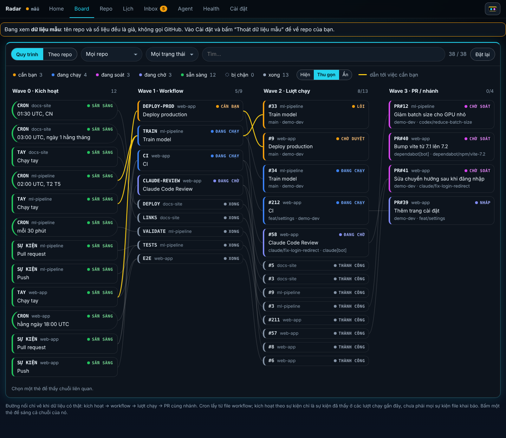
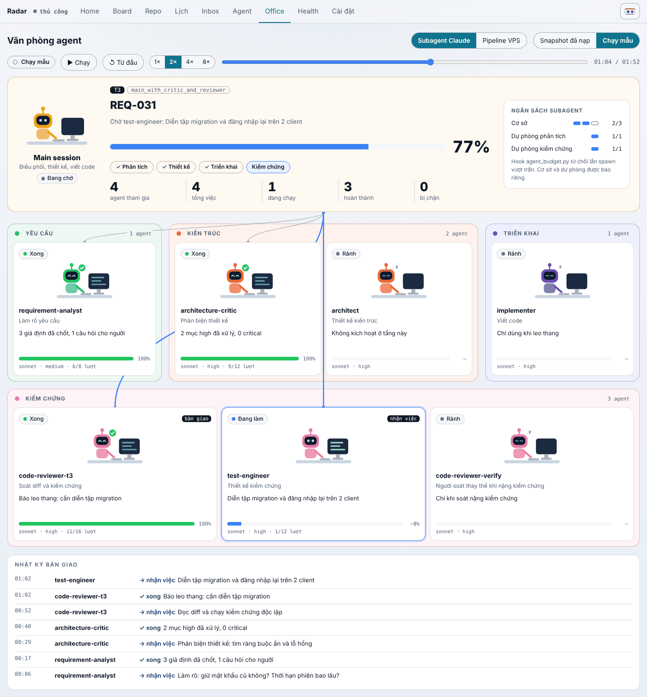

# Repo Dashboard

Một trang HTML duy nhất, **chỉ đọc**, để theo dõi nhiều repo GitHub trên một màn hình: repo nào đang có task chạy, task đó gồm những job và bước nào, quy trình (workflow) nào đang lỗi, lịch cron trong 7 ngày tới, PR nào chờ bạn, và agent nào đang làm gì, kể cả trong một **văn phòng agent** có robot ngồi bàn (tab Office).



*Ảnh là dữ liệu mẫu (tên repo và số liệu đều giả), chụp ở giao diện Neon.*



*Tab Office phát lại lượt chạy mẫu của Văn phòng agent (một yêu cầu T3, phút 01:04), chụp ở giao diện Neon sáng.*

Không cài gì, không máy chủ riêng, không build: `index.html` là cả ứng dụng. Trang chỉ nói chuyện với `api.github.com`, chỉ bằng `GET`, và token (nếu bạn dán) chỉ nằm trong bộ nhớ của trang.

## Xem thử trong một phút

```bash
git clone https://github.com/vohoailinh90/Repo_Dashboard.git
cd Repo_Dashboard
python3 -m http.server 8123          # rồi mở http://localhost:8123/
```

Vào **Cài đặt** và bấm **Xem dữ liệu mẫu**: trang dựng ba repo giả bằng đúng mã dùng cho dữ liệu thật, không gọi mạng. Mở thẳng file `index.html` cũng được.

> **Đừng** đặt trang này lên GitHub Pages `github.io` của tài khoản: mọi trang của cùng một chủ dùng chung một origin ở đó, nên script của trang khác có thể đọc ô token. Trang tự từ chối nhận token ở đó. Dùng `localhost` hoặc một tên miền riêng.

## Dùng với repo thật

1. Vào **Cài đặt → Repo đã liên kết**, gõ `chủ/tên` (hoặc dán link github.com), hoặc bấm *Chọn từ tài khoản*.
2. Repo công khai đọc được **không cần token** (60 yêu cầu/giờ cho mỗi IP). Muốn đọc repo private, hay tự làm mới liên tục: tạo token **fine-grained, chỉ đọc**, chọn đúng các repo, quyền *Metadata, Actions, Pull requests, Contents: Read*, và dán vào ô token. Đừng dùng token có quyền ghi: trang này không cần.
3. Danh sách repo được nhớ trong trình duyệt (chỉ tên, không bao giờ token).

Chi tiết từng con số lấy từ đâu, chi phí yêu cầu, những gì đã kiểm và chưa kiểm: [`docs/board.md`](docs/board.md).

## Các màn hình

| Tab | Có gì |
|---|---|
| **Home** | Chip đếm theo bảy trạng thái, mỗi task đang chạy là một khối pipeline (giai đoạn, job chạy song song, từng bước, thời gian), ô *Sẵn sàng* và *Cần bạn* |
| **Board** | Bảng Wave: kích hoạt → workflow → lượt chạy → PR cùng nhánh, đường vàng tới việc cần bạn, bấm một thẻ để sáng cả chuỗi |
| **Repo** | Mỗi repo một thẻ với các workflow, 12 lượt gần nhất, lần chạy theo lịch kế tiếp |
| **Lịch** | Cron của 7 ngày tới, đọc từ file workflow |
| **Inbox** | Lượt lỗi hoặc chờ duyệt, PR của agent chờ soát, repo không đọc được |
| **Agent** | Snapshot của "Văn phòng agent" (nạp file) và hoạt động agent đoán được từ tên workflow, nhánh, tác giả PR |
| **Office** | Văn phòng agent vẽ lại: main session, các phòng ban, mỗi agent một robot ngồi bàn, đường bàn giao, ngân sách subagent, nhật ký; kiểu nhìn *Subagent Claude* hoặc *Pipeline VPS*; phát lại lượt chạy mẫu (chạy, dừng, tốc độ, kéo thời gian) hoặc vẽ `snapshot.json` bạn nạp |
| **Health** | Hạn mức GitHub, số yêu cầu đã gửi, tình trạng từng repo |
| **Cài đặt** | Token, chu kỳ tự làm mới, liên kết repo, xuất/nhập, dữ liệu mẫu |

Bốn giao diện (**Neon**, **Classic**, **Aurora**, **Candy**) × sáng, tối hoặc theo hệ thống; chọn ở nút góc trên bên phải.

## Những điều cần biết

- **Chỉ thấy cái GitHub trả về.** Task đang chạy lấy từ 40 lượt chạy gần nhất của mỗi repo; một workflow ít chạy được đọc riêng. Mọi đường nối của bảng Wave là một quan hệ có trong dữ liệu (workflow → lượt chạy, lượt chạy → PR cùng tên nhánh), không có đường nào được vẽ cho đẹp.
- **Giai đoạn của pipeline được suy ra từ giờ chạy của job**, không đọc từ khai báo `needs`.
- **"Agent" đoán theo tên** (nhánh `claude/`, `codex/`…, tên workflow, tác giả PR), không phải trạng thái thật của phiên agent. Trạng thái thật cần snapshot của Văn phòng agent.
- **Tab Office không có dữ liệu sống**: nó phát lại lượt chạy mẫu ghi sẵn (số liệu mẫu, không phải yêu cầu thật) hoặc vẽ một snapshot bạn nạp bằng tay. Giai đoạn của main session và tiến độ từng agent là suy ra và ước lượng, như chính Văn phòng agent ghi.
- Không điều khiển được gì: không chạy, hủy hay duyệt workflow từ trang này.
- Chưa thử với token thật hay repo private; chưa thử trên trình duyệt ngoài Chromium. Danh sách đầy đủ trong `docs/board.md`.

## Phát triển

```bash
pip install -r requirements-dev.txt
python3 scripts/sync_csp.py --check     # hai mã băm CSP khớp với script và style
pytest -q                               # logic và kiểm tĩnh (cần Node)

pip install playwright && playwright install chromium
pytest -q tests/test_board_browser.py   # cùng trang trong Chromium, api.github.com do test trả lời

# ghi lại lượt chạy mẫu của tab Office từ một checkout của claude-agent-routing-template
python3 scripts/office_sample.py --template ../claude-agent-routing-template
```

Sửa script hoặc style của `index.html` thì chạy `python3 scripts/sync_csp.py` để ghi lại mã băm, nếu không trình duyệt sẽ từ chối chạy trang (đó là mục đích của chính sách băm).

## Ghi công

- Bố cục và cách thể hiện (bảng Wave, khối pipeline, thanh điều hướng, ô chọn giao diện) làm theo ba ảnh chụp do chủ repo cung cấp; **không chép mã** từ nguồn nào.
- Màu trạng thái và dải lịch sử theo token của [Automation-UI-Kit](https://github.com/vohoailinh90/Automation-UI-Kit) (MIT).
- Phần agent thật đọc snapshot của "Văn phòng agent" trong `claude-agent-routing-template`. Tab Office vẽ lại giao diện của Văn phòng ấy (hình robot bằng SVG, bảng màu phòng ban lấy từ Automation-UI-Kit, cách đặt đường nối, câu chữ tiếng Việt) bằng HTML thuần, không mang mã React sang; lượt chạy mẫu do chính `scripts/office/snapshot.py` của repo đó làm ra.

## Giấy phép

Chưa chọn giấy phép: chủ repo quyết định. Khi chưa có, mặc định là bản quyền được giữ nguyên.
